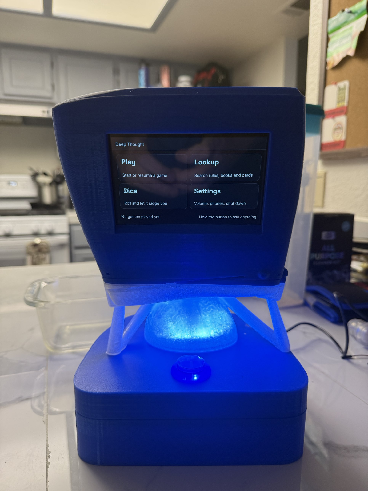

# Deep Thought: a game night box



Deep Thought sits on the table on game night. She keeps the turn order and the scores,
teaches new players while they play, answers rules questions out loud, rolls dice, and has
opinions about all of it. She is a Raspberry Pi 2 in a 3D-printed body with a 5 inch touch
screen, one lit button, a ring of LEDs under a clear dome, a speaker and a microphone.

**Start with [BUILD_GUIDE.md](BUILD_GUIDE.md).** It covers the parts, the printing, the wiring,
the Pi, the program and her voice, and then lists every problem met along the way and how
each one was found and fixed.

## What she does

- **One button.** Press = next. Hold = ask her something. Double press = undo.
- **Six full games** with their own screens: Kill Team, Warhammer 40,000, Dungeons & Dragons
  (initiative, character sheets, a DM desk), Magic: The Gathering, Risk, and a scorekeeper
  for anything else.
- **Twenty-three more** as simple entries with turn order, scores and a "How to play".
- **Teach as we play:** each rule comes up as a card at the moment it matters, read aloud.
- **Spoken questions,** answered in her own voice from her own notes and your own rulebooks.
- **Phone pages:** a shared scoreboard and a page for each player's seat, over home Wi-Fi.

## Try it without any hardware

The whole program runs on a PC in a window. The space bar is the button and Esc quits.

```
cd software
python -m venv .venv
.venv/Scripts/pip install -r requirements.txt      # .venv/bin/pip on Linux and macOS
.venv/Scripts/python run.py
```

Run the checks (each file ends by printing `0 failed`):

```
.venv/Scripts/python tests/test_engine.py
```

Her voice and her spoken answers need two cloud keys in `software/config.toml`; see
[software/VOICE.md](software/VOICE.md). Without them she still runs every game and shows her
lines as text.

## What is in here

| Folder | Contents |
|---|---|
| `software/` | The program, its tests and tools. `PI_SETUP.md`, `VOICE.md`, `LIBRARY.md` and `PLUGINS.md` are the guides. |
| `software/deepthought/games/` | One folder per game. Most need two small files and no code. |
| `cad/scripts/` | The Blender Python scripts that cut the body into printable parts and measured them. |
| `guide_images/` | The wiring diagrams and the pictures for the assembly guide. |
| `docs/` | The parts list, the assembly guide and the software design. |
| `mockups/` | The thirty screen designs the program was built from. |
| `ROADMAP.md` | What is built, what is untested and what is missing. Kept honest. |

## What is not in here

- **The printable STL files.** The body was cut from someone else's free model, so only the
  cutting scripts are here. Any body will do.
- **Any rulebook text.** Nothing here is copied from a rulebook, codex, adventure or card.
  She teaches in her own words, and real rulebooks are loaded by their owner from their own
  files into a library that never leaves the box.
- **Keys, recordings and saved games.** These are made on your own machine.

## Make it into something

This is one person's box for one table. Things that would make it better, roughly in order
of how much they would help:

- A port to a Pi with built-in Wi-Fi, or a Pi Zero 2 W.
- More games. A game is a folder; see [software/PLUGINS.md](software/PLUGINS.md).
- Checked "How to play" text for the shelf games, which were written from memory.
- A louder amplifier and speaker that still fit the head.
- Speech recognition and a voice that run on the box, with no cloud.
- A different body. Nothing in the program cares what shape she is.

## How it was made

Designed, printed, wired and assembled by Ethan. The program, the tests and the documents
were written with Claude Code (Anthropic's coding assistant) under his direction, and tested
on the real hardware as it came together. `CLAUDE.md` is the project file that assistant
reads; it is left in because it is also the shortest accurate description of the project.

## Licence

The program, scripts and documents are under the MIT licence: do what you like with them,
keep the notice. See [LICENSE](LICENSE). The two fonts in `software/deepthought/assets/fonts/`
are under the SIL Open Font Licence, and their licence files sit beside them.

## Names

This is an unofficial hobby project. It is not affiliated with or endorsed by Games Workshop,
Wizards of the Coast, Hasbro, or the publisher of any game it can keep score for. All game
names are trademarks of their owners and are used only to say which game is on the table.
Magic card data is fetched by the owner from Scryfall and is not stored in this repository.
